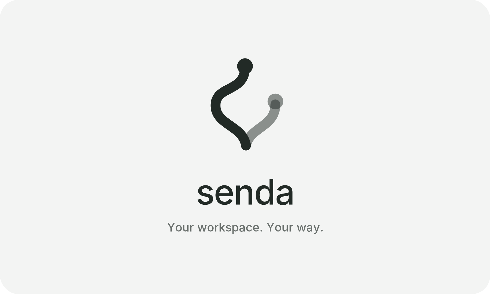

# Terminal Workspace

A lightweight, local-first desktop workspace for Git projects, worktrees, and real terminal sessions. Product intent and scope are in [`docs/intent.md`](docs/intent.md); requirements and Milestone 0 acceptance criteria are in [`docs/spec.md`](docs/spec.md).

## Current stage

This repository currently contains the product documents and a bounded Milestone 0 plan. The Tauri/Rust stack is still a candidate pending a native terminal and workspace-recovery spike on macOS, Windows, and Linux.

Start with:

1. [`docs/milestones/m0-terminal-workspace-spike.md`](docs/milestones/m0-terminal-workspace-spike.md)
2. [`docs/superpowers/plans/2026-11-20-m0-terminal-workspace.md`](docs/superpowers/plans/2026-11-20-m0-terminal-workspace.md)
3. [`docs/adr/0001-stack.md`](docs/adr/0001-stack.md)

No application code has been scaffolded yet. The current authoring environment is macOS with Node.js, npm, and Git available; Rust/Cargo are not installed, so the Tauri/Rust spike cannot be compiled here until that prerequisite is addressed. Windows and Linux validation require native environments for those platforms.
