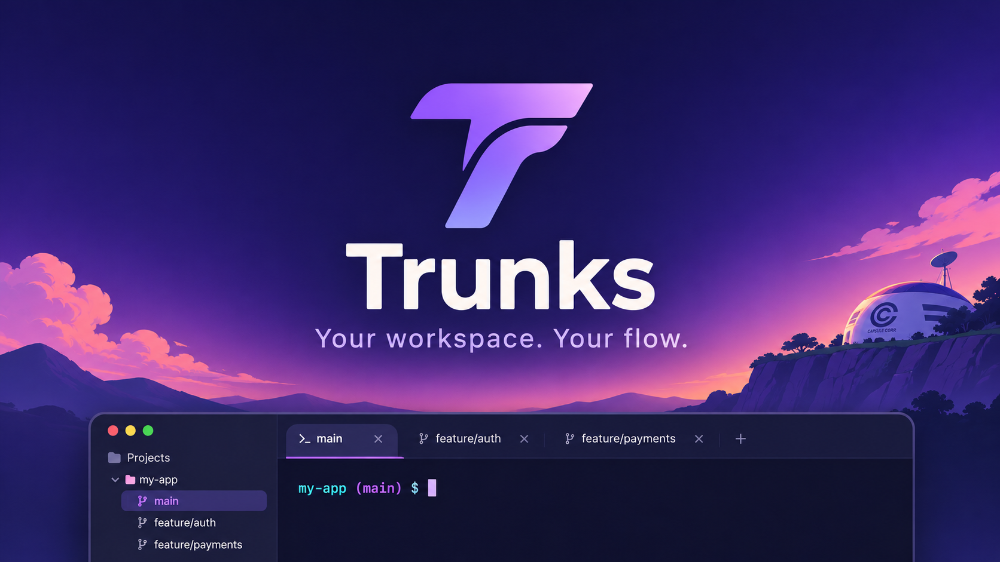

# Terminal Workspace

A lightweight, local-first desktop workspace for Git projects, worktrees, and real terminal sessions. Product intent and scope are in [`docs/intent.md`](docs/intent.md); requirements and Milestone 0 acceptance criteria are in [`docs/spec.md`](docs/spec.md).

## Multi-Agent Collaboration

This repository is developed cooperatively across multiple AI agents (Junie, Codex, Claude) and humans. If you are an AI agent starting a session, read [`AGENTS.md`](AGENTS.md) first.

## Current stage

The repository has completed Tasks 1, 2, and 3 of Milestone 0:
- **Task 1:** Development environment provisioned (Node.js, Rust/Cargo), base scaffold created with Tauri 2, Svelte 5, TypeScript, and Rust with a 3-region layout.
- **Task 2:** Validated PTY lifecycle and terminal fidelity (`portable-pty` in Rust + `@xterm/xterm` in Svelte 5). Multi-tab management, PTY creation, non-blocking I/O streaming, dynamic resize without process interruption, and automated tests passing on macOS (`docs/milestones/m0-results.md`).
- **Task 3:** Incremental persistence and crash recovery validated (`SQLite` / `rusqlite` in WAL mode). Relational schema for layout, projects, worktrees, and tabs; startup reconciliation of stale/missing paths; cold recovery of tabs marked as stopped without ghost processes (`docs/milestones/m0-results.md`).

**Next Objective:** Task 4 — Decide candidate stack from evidence, finalize evaluation matrix (`AC-M0-01` to `AC-M0-09`), and update `docs/adr/0001-stack.md`.

Start with:

1. [`AGENTS.md`](AGENTS.md) — Multi-agent collaboration protocol & onboarding
2. [`docs/milestones/m0-terminal-workspace-spike.md`](docs/milestones/m0-terminal-workspace-spike.md)
3. [`docs/superpowers/plans/2026-11-20-m0-terminal-workspace.md`](docs/superpowers/plans/2026-11-20-m0-terminal-workspace.md)
4. [`docs/adr/0001-stack.md`](docs/adr/0001-stack.md)

### Development & Build Commands

- **Frontend build/check:** `npm run check` and `npm run build`
- **Native Tauri build:** `npm run tauri build` or `cargo build --manifest-path src-tauri/Cargo.toml`
- **Development mode:** `npm run tauri dev`
